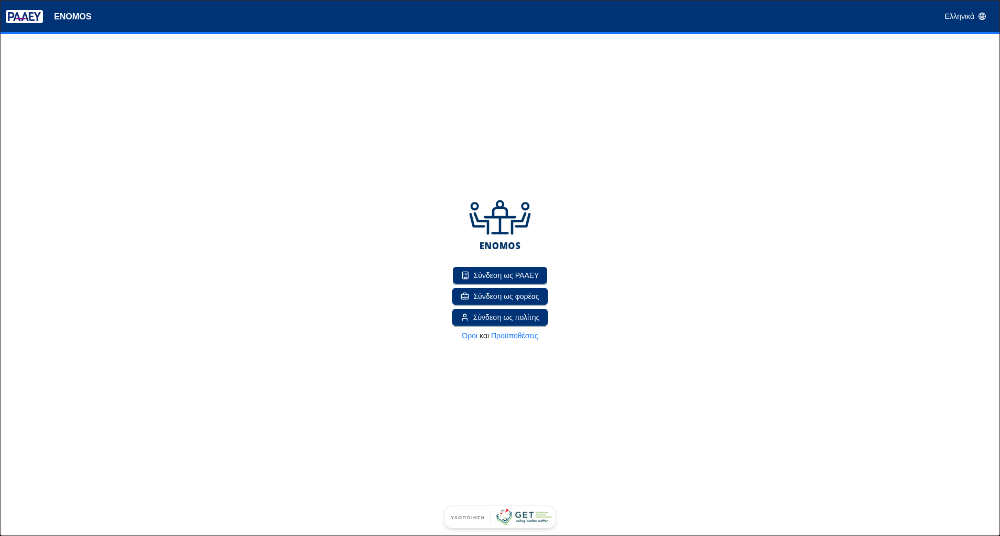
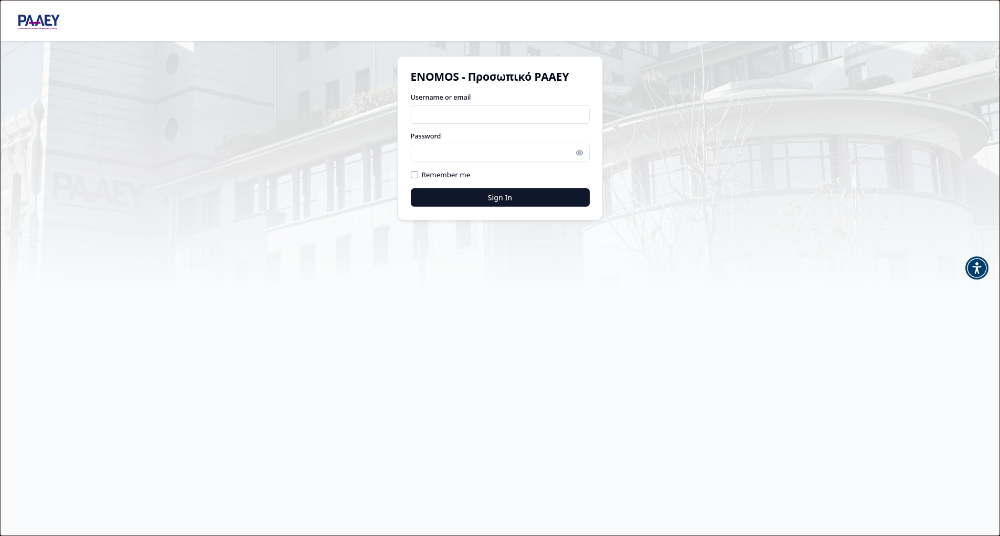
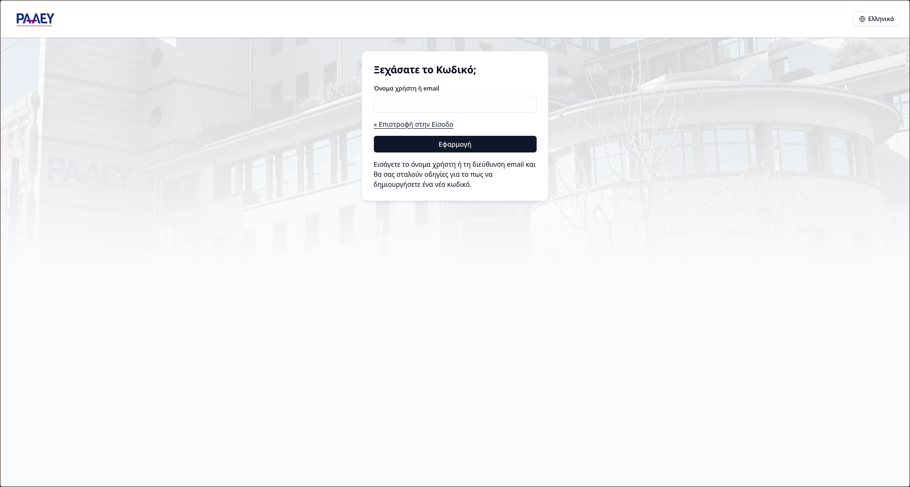

# Πρόσβαση

Για να χρησιμοποιήσετε την πλατφόρμα **Enomos** ως εσωτερικός χρήστης, συνδέεστε με τον λογαριασμό σας στο Enomos. Στην ενότητα αυτή περιγράφεται πώς συνδέεστε και πώς επαναφέρετε τον κωδικό σας.

!!! note

    Όπως και στους φορείς, ο λογαριασμός εσωτερικού χρήστη **δεν είναι κοινός με την πλατφόρμα myraaey.gr**. Χρησιμοποιήστε τα στοιχεία σύνδεσης του λογαριασμού σας στο Enomos.

## Σύνδεση ως ΡΑΑΕΥ

Από την αρχική σελίδα της πλατφόρμας, πατήστε το κουμπί **Σύνδεση ως ΡΑΑΕΥ**.

## Σύνδεση

Μεταφέρεστε στη φόρμα σύνδεσης. Από εδώ μπορείτε να:

- **συνδεθείτε** με τα στοιχεία του λογαριασμού σας στο Enomos,
- **επαναφέρετε τον κωδικό σας** (βλ. [Ξέχασα τον κωδικό μου](#forgot-password)).

Μετά τη σύνδεση, οι **διαχειριστές** μεταφέρονται στον [Πίνακα ελέγχου](dashboard.md).

## Ξέχασα τον κωδικό μου { #forgot-password }

Αν δεν θυμάστε τον κωδικό σας:

1. Στη φόρμα σύνδεσης, πατήστε **Ξέχασα τον κωδικό μου**.
2. Συμπληρώστε το **email** του λογαριασμού σας.
3. Πατήστε **Εφαρμογή**.

Θα λάβετε email με οδηγίες για την επαναφορά του κωδικού σας.

