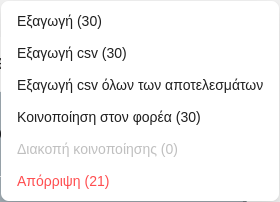
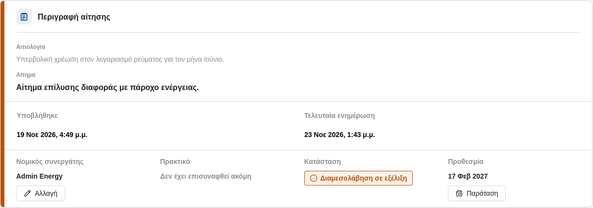
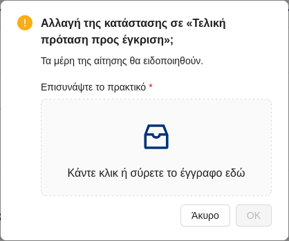
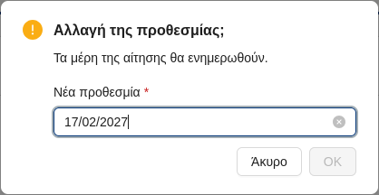
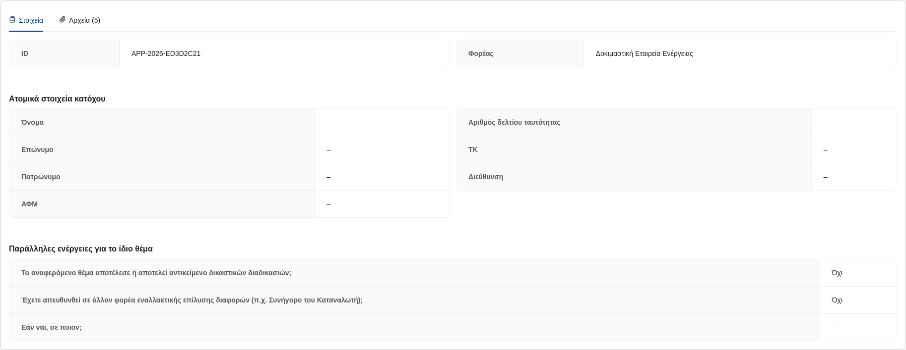
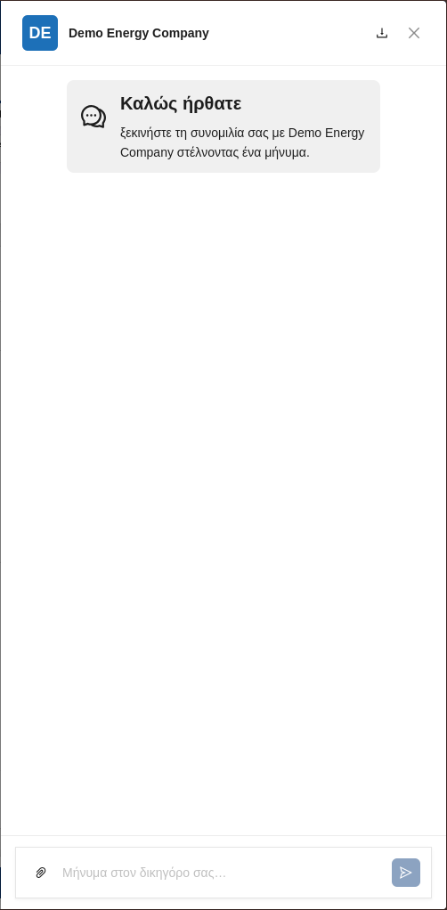

# Αιτήσεις

Η σελίδα **Αιτήσεις** συγκεντρώνει σε έναν πίνακα τις αιτήσεις διαμεσολάβησης της πλατφόρμας **Enomos** που σας αφορούν.

!!! info

    Η σελίδα είναι διαθέσιμη μόνο στους **διαχειριστές** και στους **δικηγόρους** της ΡΑΑΕΥ. Οι **υπερδιαχειριστές** δεν έχουν πρόσβαση στις αιτήσεις.

## Λίστα αιτήσεων { #list }

Οι αιτήσεις που εμφανίζονται στον πίνακα εξαρτώνται από τον ρόλο σας:

| Ρόλος | Αιτήσεις που βλέπετε |
|-------|----------------------|
| **Διαχειριστής** | Όλες τις αιτήσεις των τομέων σας (**Ύδατα**, **Απόβλητα**, **Ενέργεια**). |
| **Δικηγόρος** | Τις αιτήσεις στις οποίες σας έχει ορίσει νομικό συνεργάτη ένας διαχειριστής (βλ. [Ορισμός νομικού συνεργάτη](#assign-representative)). |

Για κάθε αίτηση, ο πίνακας εμφανίζει τις παρακάτω πληροφορίες:

| Στήλη | Περιγραφή |
|-------|-----------|
| **ID** | Ο μοναδικός κωδικός της αίτησης. |
| **Κατάσταση** | Η τρέχουσα κατάσταση της αίτησης (βλ. [Καταστάσεις αιτήσεων](#statuses)). |
| **Κοινοποίηση** | Αν η αίτηση είναι **Κοινοποιημένη στον φορέα** ή **μη κοινοποιημένη** (βλ. [Ενέργειες αίτησης](#actions)). |
| **Φορέας** | Ο φορέας στον οποίο απευθύνεται η αίτηση. |
| **Αίτημα** | Το αντικείμενο της αίτησης. |
| **Υποβλήθηκε** | Η ημερομηνία υποβολής της αίτησης. |
| **Προθεσμία** | Η τρέχουσα [προθεσμία](#deadlines) της αίτησης. Οι εκπρόθεσμες αιτήσεις εμφανίζονται με **κόκκινο**. |
| **Τελευταία ενημέρωση** | Η ημερομηνία της τελευταίας αλλαγής στην αίτηση. |

Κάτω από τον πίνακα εμφανίζεται το **πλήθος** των αιτήσεων που ταιριάζουν στα [φίλτρα](#filters) (π.χ. **1–30 από 85**).

!!! tip

    Πατήστε την επικεφαλίδα της στήλης **Προθεσμία** για να ταξινομήσετε τις αιτήσεις με βάση την προθεσμία τους.

## Φίλτρα { #filters }

Οι επιλογές φίλτρων βρίσκονται πάνω δεξιά από τον πίνακα. Μπορείτε να φιλτράρετε τις αιτήσεις με βάση:

- **ID**: πληκτρολογήστε τον κωδικό ή μέρος του.
- **Κατάσταση**: επιλέξτε μία ή περισσότερες [καταστάσεις](#statuses).
- **Κοινοποίηση**: επιλέξτε **Όλα**, **Κοινοποιημένη στον φορέα** ή **μη κοινοποιημένη**.
- **Αίτημα**: πληκτρολογήστε κείμενο που περιέχεται στο αίτημα.

## Μαζικές ενέργειες { #bulk-actions }

Μπορείτε να εφαρμόσετε μια ενέργεια σε πολλές αιτήσεις μαζί:

1. Επιλέξτε τις αιτήσεις από το **κουτάκι** αριστερά κάθε γραμμής του [πίνακα αιτήσεων](#list). Η **Εξαγωγή csv όλων των αποτελεσμάτων** δεν χρειάζεται επιλογή.
2. Πατήστε το κουμπί **Ενέργειες** πάνω δεξιά από τον πίνακα.
3. Επιλέξτε μία από τις παρακάτω ενέργειες και επιβεβαιώστε:

| Ενέργεια | Περιγραφή |
|----------|-----------|
| **Εξαγωγή** | [Εξάγει](#export) τις επιλεγμένες αιτήσεις. |
| **Εξαγωγή csv** | [Εξάγει σε CSV](#export-csv) τις επιλεγμένες αιτήσεις. |
| **Εξαγωγή csv όλων των αποτελεσμάτων** | [Εξάγει σε CSV](#export-csv) **όλες** τις αιτήσεις που ταιριάζουν στα [φίλτρα](#filters), σε όλες τις σελίδες του πίνακα. |
| **Κοινοποίηση στον φορέα** | Διαμοιράζει με τον φορέα τους τις επιλεγμένες αιτήσεις που δεν είναι ήδη κοινοποιημένες. |
| **Διακοπή κοινοποίησης** | Σταματά τον διαμοιρασμό των επιλεγμένων αιτήσεων που είναι κοινοποιημένες. |
| **Απόρριψη** | Απορρίπτει τις επιλεγμένες αιτήσεις που βρίσκονται σε εξέλιξη. Οι αιτήσεις περνούν σε **Απόρριψη αιτήματος**. |

Δίπλα σε κάθε ενέργεια εμφανίζεται σε **πόσες** από τις επιλεγμένες αιτήσεις θα εφαρμοστεί. Οι αιτήσεις στις οποίες δεν έχει νόημα η ενέργεια παραλείπονται. Στο τέλος εμφανίζεται πόσες αιτήσεις ενημερώθηκαν.

## Καταστάσεις αιτήσεων { #statuses }

Μια αίτηση μπορεί να βρίσκεται σε μία από τις παρακάτω καταστάσεις:

| Κατάσταση | Περιγραφή |
|-----------|-----------|
| **Πρόχειρο** | Η αίτηση έχει δημιουργηθεί από τον πολίτη αλλά δεν έχει υποβληθεί ακόμη. |
| **Παραλαβή αιτήματος** | Η αίτηση έχει υποβληθεί και παραληφθεί. |
| **Διαμεσολάβηση σε εξέλιξη** | Έχει οριστεί νομικός συνεργάτης και η διαμεσολάβηση βρίσκεται σε εξέλιξη. |
| **Τελική πρόταση προς έγκριση** | Ο νομικός συνεργάτης έχει αναρτήσει το πρακτικό και αναμένεται η έγκρισή του από διαχειριστή. |
| **Επιτυχής διαμεσολάβηση** | Η διαμεσολάβηση ολοκληρώθηκε με επιτυχία. |
| **Αποτυχημένη διαμεσολάβηση** | Η διαμεσολάβηση ολοκληρώθηκε χωρίς συμφωνία. |
| **Απόρριψη αιτήματος** | Το αίτημα απορρίφθηκε (βλ. [Ενέργειες αίτησης](#actions)). |

## Προβολή αίτησης { #view }

Για να δείτε μια αίτηση, πατήστε το **ID** της στον [πίνακα αιτήσεων](#list). Μεταφέρεστε στη σελίδα προβολής της αίτησης.

### Περιγραφή αίτησης

Πάνω αριστερά βρίσκεται η καρτέλα με την **περιγραφή** της αίτησης:

- **Αιτιολογία**
- **Αίτημα**
- **Υποβλήθηκε**
- **Τελευταία ενημέρωση**
- **Νομικός συνεργάτης οργανισμού**
- **Κατάσταση**
- **Προθεσμία**: η τρέχουσα [προθεσμία](#deadlines) της αίτησης, με το κουμπί **Παράταση**. Αν η προθεσμία έχει περάσει, εμφανίζεται η ένδειξη **Εκπρόθεσμη**.
- **Πρακτικό**: το έγγραφο που αναρτά ο νομικός συνεργάτης της ΡΑΑΕΥ κατά τη διαμόρφωση της τελικής πρότασης (βλ. [Ανάρτηση πρακτικού](#upload-minutes)).

### Κατάσταση αίτησης { #status-card }

Δεξιά της περιγραφής βρίσκεται η καρτέλα **κατάστασης**, με όλα τα στάδια της αίτησης και την [κατάσταση](#statuses) στην οποία βρίσκεται αυτή τη στιγμή. Από την καρτέλα αυτή προωθείτε την αίτηση από στάδιο σε στάδιο.

Η ροή μιας αίτησης είναι η εξής:

1. Η αίτηση δημιουργείται ως **Πρόχειρο** μέχρι ο πολίτης να συμπληρώσει και να υποβάλει τη φόρμα της αίτησης.
2. Με την υποβολή, η αίτηση περνά σε **Παραλαβή αιτήματος**.
3. Ένας διαχειριστής [ορίζει νομικό συνεργάτη](#assign-representative). Η αίτηση περνά σε **Διαμεσολάβηση σε εξέλιξη**.
4. Ο νομικός συνεργάτης, αφού επικοινωνήσει με τον πολίτη και, αν χρειάζεται, με τον φορέα, [αναρτά το πρακτικό](#upload-minutes). Η αίτηση περνά σε **Τελική πρόταση προς έγκριση**.
5. Ένας διαχειριστής εξετάζει το πρακτικό και [ολοκληρώνει την αίτηση](#complete). Η αίτηση περνά σε **Επιτυχής διαμεσολάβηση** ή **Αποτυχημένη διαμεσολάβηση**.

#### Ορισμός νομικού συνεργάτη { #assign-representative }

!!! info

    Η λειτουργία αυτή είναι διαθέσιμη μόνο στους **διαχειριστές**.

Όταν η αίτηση βρίσκεται σε **Παραλαβή αιτήματος**, ορίστε τον νομικό συνεργάτη της ΡΑΑΕΥ που θα αναλάβει την υπόθεση:

1. Στην καρτέλα **κατάστασης**, πατήστε **Ορισμός νομικού συνεργάτη**.
2. Στο παράθυρο που ανοίγει, επιλέξτε έναν **διαχειριστή** ή έναν **δικηγόρο**.
3. Επιβεβαιώστε την επιλογή σας.

Η αίτηση περνά σε **Διαμεσολάβηση σε εξέλιξη** και εμφανίζεται στον [πίνακα αιτήσεων](#list) του νομικού συνεργάτη που ορίσατε.

#### Ανάρτηση πρακτικού { #upload-minutes }

Όταν η διαμεσολάβηση βρίσκεται σε εξέλιξη, ο νομικός συνεργάτης αναρτά το **πρακτικό** με την τελική πρόταση:

1. Στην καρτέλα **κατάστασης**, πατήστε **Επισύναψη πρακτικού**.
2. Στη φόρμα ανάρτησης πρακτικού, επιλέξτε το έγγραφο.
3. Πατήστε **Ανάρτηση**.

Η αίτηση περνά σε **Τελική πρόταση προς έγκριση** και το πρακτικό εμφανίζεται στην [περιγραφή της αίτησης](#view).

#### Ολοκλήρωση αίτησης { #complete }

!!! info

    Η λειτουργία αυτή είναι διαθέσιμη μόνο στους **διαχειριστές**.

Όταν η αίτηση βρίσκεται σε **Τελική πρόταση προς έγκριση**, εξετάστε το πρακτικό και, από την καρτέλα **κατάστασης**, πατήστε:

- **Επιτυχής ολοκλήρωση**: η αίτηση περνά σε **Επιτυχής διαμεσολάβηση**.
- **Ανεπιτυχής ολοκλήρωση**: η αίτηση περνά σε **Αποτυχημένη διαμεσολάβηση**.

#### Επαναφορά σε προηγούμενο στάδιο { #revert }

!!! info

    Η λειτουργία αυτή είναι διαθέσιμη μόνο στους **διαχειριστές**.

Ανά πάσα στιγμή, ένας διαχειριστής μπορεί να επαναφέρει την αίτηση στο προηγούμενο στάδιο από την καρτέλα **κατάστασης**. Η επαναφορά **αναιρεί το τρέχον βήμα**.

### Προθεσμίες { #deadlines }

Κάθε αίτηση έχει μία **τρέχουσα προθεσμία**, σύμφωνα με τον Κανονισμό Λειτουργίας. Η προθεσμία ορίζεται αυτόματα από την [κατάσταση](#statuses) της αίτησης και **αντικαθίσταται σε κάθε αλλαγή κατάστασης**:

| Κατάσταση | Προθεσμία | Για |
|-----------|-----------|-----|
| **Παραλαβή αιτήματος** | 20 εργάσιμες ημέρες από την παραλαβή. | Την απόφαση της ΡΑΑΕΥ για την εξέταση της υπόθεσης. |
| **Διαμεσολάβηση σε εξέλιξη** | 90 ημέρες από την παραλαβή. Αν η ημέρα δεν είναι εργάσιμη, μεταφέρεται στην επόμενη εργάσιμη. | Την ολοκλήρωση της διαμεσολάβησης. |
| **Τελική πρόταση προς έγκριση** | 10 εργάσιμες ημέρες από την ημέρα που η αίτηση πέρασε στην κατάσταση αυτή. | Την απάντηση των μερών στην τελική πρόταση. |
| Οποιαδήποτε άλλη | Χωρίς προθεσμία. | – |

Περνώντας τον δείκτη πάνω από την προθεσμία, εμφανίζεται για ποιο στάδιο ισχύει.

!!! info

    - **Παραλαβή** είναι η ημέρα που η αίτηση έφτασε για πρώτη φορά σε **Παραλαβή αιτήματος**, συνήθως η ημέρα υποβολής της από τον πολίτη. Δεν αλλάζει μετά.
    - Οι **εργάσιμες ημέρες** παραλείπουν τα Σαββατοκύριακα και τις ενεργές [αργίες](holidays.md).
    - Οι αλλαγές στις αργίες **δεν μετακινούν** τις προθεσμίες που έχουν ήδη οριστεί.

#### Παράταση προθεσμίας { #extend-deadline }

Όσο η αίτηση βρίσκεται σε εξέλιξη, οι **διαχειριστές** και ο **νομικός συνεργάτης** της αίτησης μπορούν να αλλάξουν την προθεσμία:

1. Στην [περιγραφή της αίτησης](#view), πατήστε **Παράταση** δίπλα στην προθεσμία.
2. Επιλέξτε τη **νέα προθεσμία**. Δεν μπορείτε να επιλέξετε ημερομηνία που έχει περάσει.
3. Επιβεβαιώστε την αλλαγή.

Ο πολίτης και, αν η αίτηση είναι κοινοποιημένη, ο φορέας ενημερώνονται για τη νέα προθεσμία.

#### Υπενθυμίσεις προθεσμίας { #deadline-reminders }

Η πλατφόρμα στέλνει [υπενθύμιση](settings.md#notifications) **3 ημέρες**, **1 ημέρα** και **την ημέρα** της προθεσμίας, καθώς και μία φορά **την επόμενη ημέρα** αν η προθεσμία έχει περάσει. Την υπενθύμιση λαμβάνει ο **νομικός συνεργάτης** της αίτησης ή, αν δεν έχει οριστεί, οι **διαχειριστές** των τομέων του φορέα.

!!! note

    Για αιτήσεις σε **Τελική πρόταση προς έγκριση** που είναι κοινοποιημένες, υπενθύμιση λαμβάνει και ο φορέας. Ο πολίτης δεν λαμβάνει υπενθυμίσεις.

### Στοιχεία και αρχεία

Από κάτω βρίσκεται μια καρτέλα με δύο ενότητες:

=== "Στοιχεία"

    Εμφανίζονται όλα όσα συμπλήρωσε ο πολίτης στη φόρμα της αίτησης:

    - **ID** της αίτησης και **φορέας**
    - **Ατομικά στοιχεία κατόχου**: όνομα, επώνυμο, πατρώνυμο, ΑΦΜ, αριθμός δελτίου ταυτότητας, ΤΚ και διεύθυνση
    - **Παράλληλες ενέργειες για το ίδιο θέμα**: αν το θέμα αποτέλεσε ή αποτελεί αντικείμενο δικαστικών διαδικασιών και αν ο πολίτης έχει απευθυνθεί σε άλλον φορέα εναλλακτικής επίλυσης διαφορών (π.χ. Συνήγορο του Καταναλωτή)

    

=== "Αρχεία"

    Εμφανίζονται τα αρχεία του **πολίτη**, του **φορέα** (αν υπάρχουν) και τα **εσωτερικά** αρχεία της ΡΑΑΕΥ, όπως το πρακτικό. Μπορείτε να **κατεβάσετε** οποιοδήποτε αρχείο.

    Δίπλα σε κάθε αρχείο υπάρχει το κουμπί **Κοινοποίηση**:

    | Αρχείο | Μπορεί να κοινοποιηθεί |
    |--------|------------------------|
    | Του πολίτη | Στον φορέα. |
    | Του φορέα | Στον πολίτη. |
    | Εσωτερικό (π.χ. πρακτικό) | Στον φορέα, στον πολίτη ή και στους δύο. |

    

    

### Ενέργειες αίτησης { #actions }

Πάνω δεξιά στη σελίδα της αίτησης βρίσκονται τα παρακάτω κουμπιά:

- **Εξαγωγή αίτησης**: [εξάγει](#export) την αίτηση.
- **Κοινοποίηση στον φορέα**: διαμοιράζει την αίτηση με τον φορέα. Από εκείνη τη στιγμή οι διαχειριστές του φορέα βλέπουν την αίτηση.
- **Απόρριψη**: απορρίπτει την αίτηση. Η αίτηση περνά σε **Απόρριψη αιτήματος**. Μόνο αιτήσεις που βρίσκονται σε εξέλιξη (**Παραλαβή αιτήματος**, **Διαμεσολάβηση σε εξέλιξη**, **Τελική πρόταση προς έγκριση**) μπορούν να απορριφθούν.

!!! tip

    Μπορείτε να κοινοποιήσετε, να διακόψετε την κοινοποίηση ή να απορρίψετε πολλές αιτήσεις μαζί από τις [μαζικές ενέργειες](#bulk-actions).

#### Εξαγωγή αίτησης { #export }

Η εξαγωγή δημιουργεί ένα αρχείο **zip** με έναν φάκελο για κάθε αίτηση, που περιέχει:

- τα **στοιχεία** της αίτησης σε **PDF**,
- τις δύο **συνομιλίες** (με τον πολίτη και με τον φορέα) σε υπολογιστικό φύλλο,
- όλα τα **αρχεία** της αίτησης.

Η εξαγωγή γίνεται στο παρασκήνιο. Όταν ολοκληρωθεί, λαμβάνετε [ειδοποίηση](settings.md#notifications) και **email** με τον σύνδεσμο λήψης.

!!! warning

    Ο σύνδεσμος λήψης λειτουργεί **μία φορά** και λήγει σε **24 ώρες**. Μπορείτε να εξαγάγετε έως **100 αιτήσεις** τη φορά.

#### Εξαγωγή σε CSV { #export-csv }

Από τις [μαζικές ενέργειες](#bulk-actions) μπορείτε να εξαγάγετε τις αιτήσεις σε ένα υπολογιστικό φύλλο **CSV**, με μία γραμμή για κάθε αίτηση. Το αρχείο ανοίγει απευθείας στο Excel και περιέχει τις στήλες:

- **Α/Α**
- **Αριθ. αιτήματος (MyRAE)**
- **Παραλήπτης**: ο φορέας της αίτησης.
- **Αίτημα καταναλωτή** και **Λόγοι**
- **Κατάσταση**
- **Υποβολή**, **Παραλαβή** και **Προθεσμία**
- **Νομικός συνεργάτης**

Όπως και η [εξαγωγή](#export), γίνεται στο παρασκήνιο: όταν ολοκληρωθεί, λαμβάνετε [ειδοποίηση](settings.md#notifications) και **email** με τον σύνδεσμο λήψης, που λειτουργεί **μία φορά** και λήγει σε **24 ώρες**.

!!! tip

    Η **Εξαγωγή csv όλων των αποτελεσμάτων** δεν έχει όριο αιτήσεων: εξάγει όλες τις αιτήσεις των [φίλτρων](#filters) σας, ακόμη κι αν ο πίνακας τις εμφανίζει σε πολλές σελίδες.

### Συνομιλίες

Κάτω δεξιά στη σελίδα βρίσκονται δύο **συνομιλίες**: μία με τον **πολίτη** και μία με τον **φορέα**. Οι συνομιλίες είναι αρχικά κλειστές· πατήστε μία για να την ανοίξετε. Από εδώ μπορείτε να στέλνετε μηνύματα και αρχεία.

!!! note

    Ο πολίτης και ο φορέας **δεν επικοινωνούν απευθείας** μεταξύ τους. Κάθε επικοινωνία περνά μέσα από τη ΡΑΑΕΥ.

!!! note

    Τα αρχεία που στέλνετε ή λαμβάνετε στις συνομιλίες εμφανίζονται και στην ενότητα **Αρχεία**.

!!! tip

    Από το πάνω δεξί μέρος κάθε συνομιλίας μπορείτε να **εξαγάγετε** τη συνομιλία σε υπολογιστικό φύλλο. Τα αρχεία της συνομιλίας δεν περιλαμβάνονται στην εξαγωγή.
