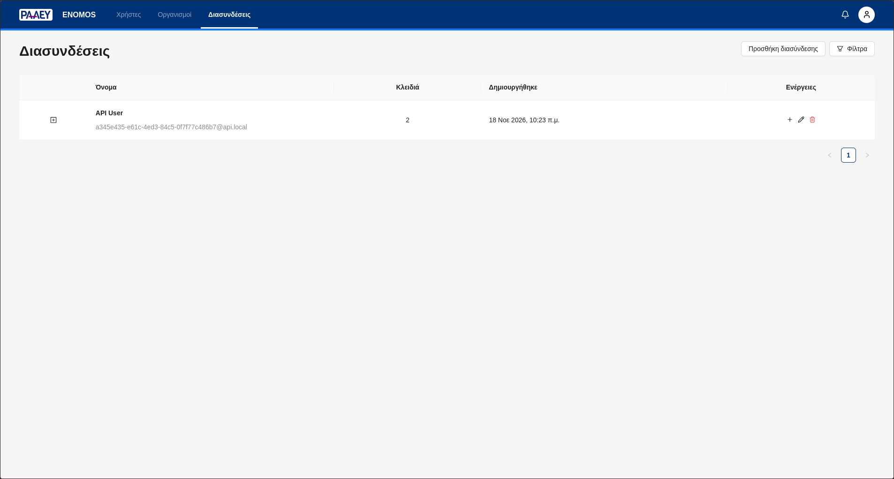
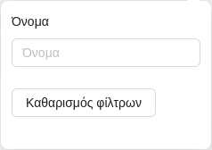
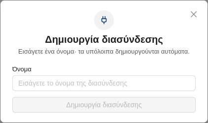
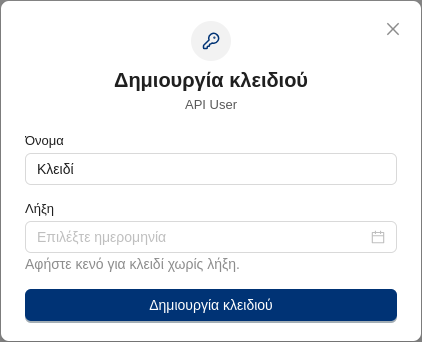
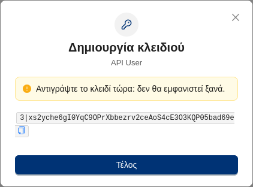
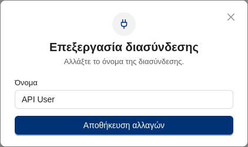
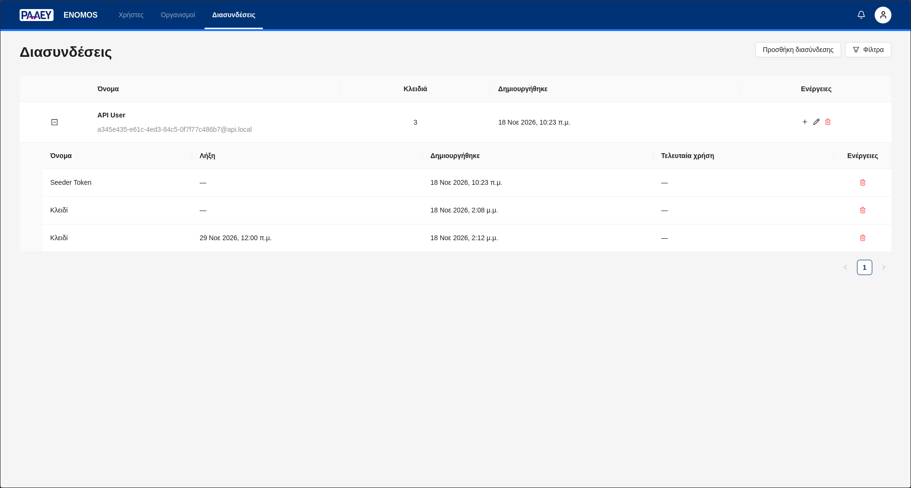

# Διασυνδέσεις

Η σελίδα **Διασυνδέσεις** συγκεντρώνει σε έναν πίνακα τους **χρήστες API** της πλατφόρμας **Enomos** και τα κλειδιά τους. Από εδώ μπορείτε να προσθέτετε νέες διασυνδέσεις και να διαχειρίζεστε τα κλειδιά τους.

!!! info

    Η σελίδα αυτή είναι διαθέσιμη μόνο στους **υπερδιαχειριστές**.

## Λίστα διασυνδέσεων { #list }

Για κάθε διασύνδεση, ο πίνακας εμφανίζει τις παρακάτω πληροφορίες:

| Στήλη | Περιγραφή |
|-------|-----------|
| **Όνομα** | Το όνομα της διασύνδεσης. |
| **Κλειδιά** | Τα κλειδιά της διασύνδεσης (βλ. [Κλειδιά διασύνδεσης](#keys)). |
| **Δημιουργήθηκε** | Η ημερομηνία δημιουργίας της διασύνδεσης. |
| **Ενέργειες** | Οι διαθέσιμες ενέργειες για τη διασύνδεση (βλ. [Ενέργειες](#actions)). |

## Φίλτρα

Οι επιλογές φίλτρων βρίσκονται πάνω δεξιά από τον πίνακα. Μπορείτε να φιλτράρετε τις διασυνδέσεις με βάση:

- **Όνομα**: πληκτρολογήστε το όνομα ή μέρος του.

## Προσθήκη διασύνδεσης { #create }

1. Πατήστε το κουμπί **Προσθήκη διασύνδεσης** πάνω δεξιά από τον πίνακα.
2. Συμπληρώστε το **Όνομα** της διασύνδεσης.
3. Πατήστε **Αποθήκευση**.

## Ενέργειες { #actions }

Από τη στήλη **Ενέργειες** του [πίνακα διασυνδέσεων](#list) μπορείτε να:

- [δημιουργήσετε κλειδί](#create-key),
- [επεξεργαστείτε](#edit) τη διασύνδεση,
- [διαγράψετε](#delete) τη διασύνδεση.

### Δημιουργία κλειδιού { #create-key }

1. Πατήστε **Δημιουργία κλειδιού**.
2. Συμπληρώστε τη φόρμα:

    | Πεδίο | Περιγραφή |
    |-------|-----------|
    | **Όνομα** | Το όνομα του κλειδιού. |
    | **Λήξη** | Η ημερομηνία λήξης του κλειδιού. Αν μείνει κενό, το κλειδί **δεν λήγει**. |

3. Πατήστε **Αποθήκευση**.

Στο παράθυρο που ανοίγει εμφανίζεται το νέο κλειδί. Πατήστε **Αντιγραφή** και αποθηκεύστε το σε ασφαλές σημείο.

!!! warning

    Το κλειδί εμφανίζεται **μόνο μία φορά**, σε αυτό το παράθυρο. Μετά το κλείσιμο του παραθύρου **δεν μπορεί να το δει κανείς ξανά**. Αν το χάσετε, δημιουργήστε νέο κλειδί και [διαγράψτε](#keys) το παλιό.

### Επεξεργασία διασύνδεσης { #edit }

Πατήστε **Επεξεργασία** για να αλλάξετε το **όνομα** της διασύνδεσης.

### Διαγραφή διασύνδεσης { #delete }

Πατήστε **Διαγραφή** και επιβεβαιώστε.

!!! danger

    Η διαγραφή μιας διασύνδεσης διαγράφει και **όλα τα κλειδιά της**. Τα συστήματα που χρησιμοποιούν αυτά τα κλειδιά χάνουν αμέσως την πρόσβαση.

## Κλειδιά διασύνδεσης { #keys }

Για να δείτε τα κλειδιά μιας διασύνδεσης, πατήστε το εικονίδιο **+** αριστερά της στον [πίνακα διασυνδέσεων](#list). Ανοίγει ένας υποπίνακας με τις παρακάτω πληροφορίες:

| Στήλη | Περιγραφή |
|-------|-----------|
| **Όνομα** | Το όνομα του κλειδιού. |
| **Λήξη** | Η ημερομηνία λήξης του κλειδιού, αν έχει οριστεί. |
| **Δημιουργήθηκε** | Η ημερομηνία δημιουργίας του κλειδιού. |
| **Τελευταία χρήση** | Η ημερομηνία που χρησιμοποιήθηκε τελευταία φορά το κλειδί. |
| **Ενέργειες** | **Διαγραφή** του κλειδιού. |

