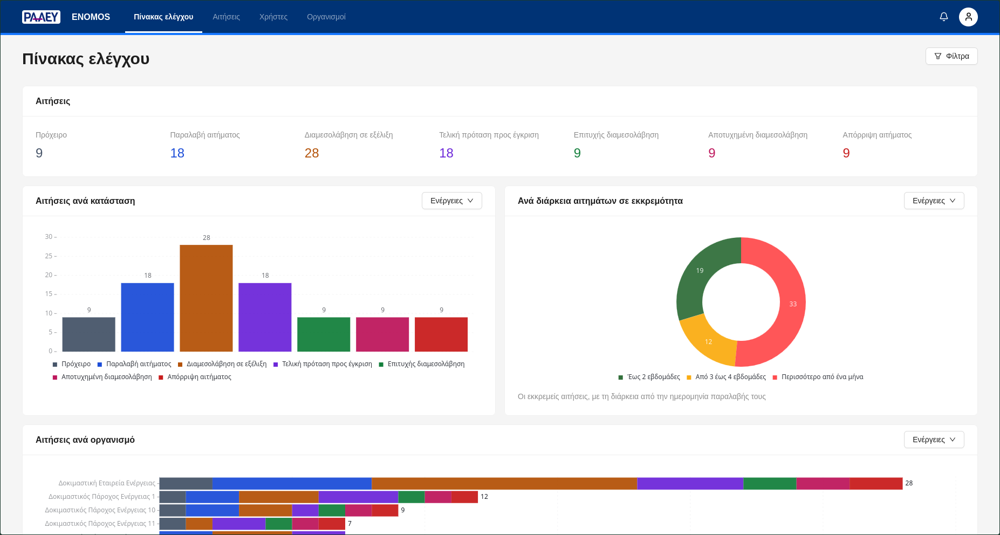
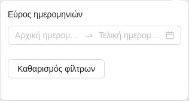
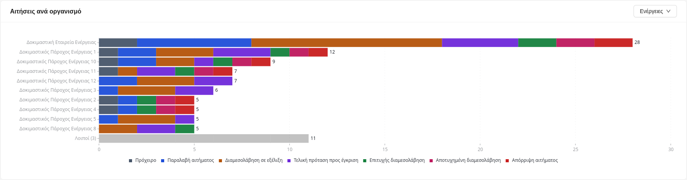
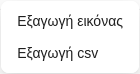

# Πίνακας ελέγχου

Ο **Πίνακας ελέγχου** συγκεντρώνει τα στατιστικά των αιτήσεων διαμεσολάβησης των τομέων σας. Είναι η πρώτη σελίδα που βλέπετε μετά τη [σύνδεση](access.md).

!!! info

    Η σελίδα είναι διαθέσιμη μόνο στους **διαχειριστές**. Τα στατιστικά αφορούν τις αιτήσεις των τομέων σας, τις ίδιες που βλέπετε στη [λίστα αιτήσεων](applications.md#list).

## Αιτήσεις ανά κατάσταση { #statistics }

Στο πάνω μέρος της σελίδας, η καρτέλα **Αιτήσεις** εμφανίζει πόσες αιτήσεις βρίσκονται σε κάθε [κατάσταση](applications.md#statuses).

## Φίλτρα { #filters }

Το κουμπί **Φίλτρα** βρίσκεται πάνω δεξιά. Επιλέξτε ένα **Εύρος ημερομηνιών** για να δείτε τα στατιστικά μόνο για τις αιτήσεις που **υποβλήθηκαν** μέσα σε αυτό. Το φίλτρο εφαρμόζεται σε όλα τα στατιστικά και τα γραφήματα της σελίδας.

Για να δείτε ξανά όλες τις αιτήσεις, πατήστε **Καθαρισμός φίλτρων**.

## Γραφήματα { #charts }

Κάτω από τα στατιστικά βρίσκονται τα παρακάτω γραφήματα:

| Γράφημα | Τι δείχνει |
|---------|------------|
| **Αιτήσεις ανά κατάσταση** | Το πλήθος των αιτήσεων σε κάθε [κατάσταση](applications.md#statuses). |
| **Ανά διάρκεια αιτημάτων σε εκκρεμότητα** | Τις αιτήσεις που βρίσκονται σε εξέλιξη (**Παραλαβή αιτήματος**, **Διαμεσολάβηση σε εξέλιξη**, **Τελική πρόταση προς έγκριση**), ανάλογα με το πόσος καιρός πέρασε από την **παραλαβή** τους: **έως 2 εβδομάδες**, **από 3 έως 4 εβδομάδες** ή **περισσότερο από ένα μήνα**. |
| **Αιτήσεις ανά οργανισμό** | Τους **10 οργανισμούς** με τις περισσότερες αιτήσεις, με χρώμα για κάθε κατάσταση. Οι υπόλοιποι οργανισμοί συγκεντρώνονται στη γκρι μπάρα **Λοιποί**, με το πλήθος τους σε παρένθεση. |

!!! tip

    Περάστε τον δείκτη του ποντικιού πάνω από μια μπάρα ή ένα τμήμα για να δείτε το ακριβές πλήθος.

## Εξαγωγή γραφήματος { #export }

Κάθε γράφημα έχει πάνω δεξιά το κουμπί **Ενέργειες**, με τις παρακάτω επιλογές:

| Ενέργεια | Περιγραφή |
|----------|-----------|
| **Εξαγωγή εικόνας** | Κατεβάζει το γράφημα ως εικόνα **PNG**. |
| **Εξαγωγή csv** | Κατεβάζει τα δεδομένα του γραφήματος ως υπολογιστικό φύλλο **CSV**. Στο γράφημα ανά οργανισμό, το αρχείο περιέχει **όλους** τους οργανισμούς, με μία στήλη για κάθε κατάσταση. |

Η λήψη γίνεται αμέσως και περιλαμβάνει μόνο τις αιτήσεις των [φίλτρων](#filters) που έχετε επιλέξει.

