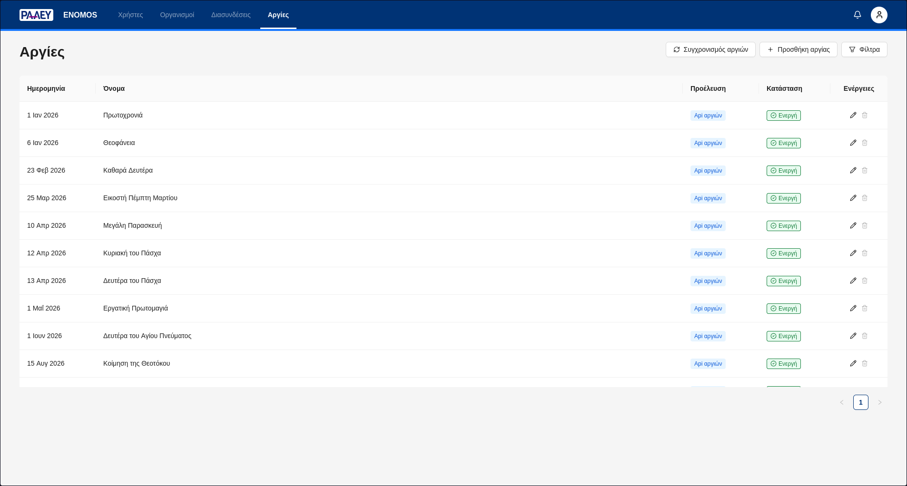
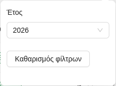
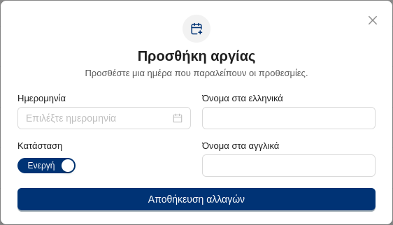
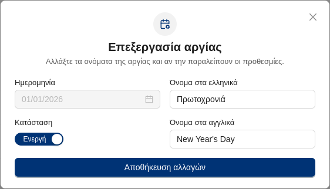

# Αργίες

Η σελίδα **Αργίες** συγκεντρώνει σε έναν πίνακα τις αργίες της πλατφόρμας **Enomos**. Οι ενεργές αργίες **δεν μετράνε ως εργάσιμες ημέρες** στον υπολογισμό των [προθεσμιών](applications.md#deadlines) των αιτήσεων.

!!! info

    Η σελίδα αυτή είναι διαθέσιμη μόνο στους **υπερδιαχειριστές**.

## Λίστα αργιών { #list }

Για κάθε αργία, ο πίνακας εμφανίζει τις παρακάτω πληροφορίες:

| Στήλη | Περιγραφή |
|-------|-----------|
| **Ημερομηνία** | Η ημερομηνία της αργίας. |
| **Όνομα** | Το όνομα της αργίας. |
| **Προέλευση** | **API αργιών**, αν η αργία προέρχεται από τον [συγχρονισμό](#sync), ή **Χειροκίνητη**, αν την πρόσθεσε υπερδιαχειριστής. |
| **Κατάσταση** | Αν η αργία είναι **Ενεργή** ή **Ανενεργή**. Μια ανενεργή αργία μετράει ως εργάσιμη ημέρα. |
| **Ενέργειες** | [Επεξεργασία](#edit) και [διαγραφή](#delete) της αργίας. |

## Φίλτρα

Οι επιλογές φίλτρων βρίσκονται πάνω δεξιά από τον πίνακα. Μπορείτε να φιλτράρετε τις αργίες με βάση:

- **Έτος**: επιλέξτε το έτος. Χωρίς φίλτρο, εμφανίζονται οι αργίες του τρέχοντος έτους.

## Συγχρονισμός αργιών { #sync }

Οι επίσημες αργίες της Ελλάδας για το τρέχον και το επόμενο έτος έρχονται από ένα εξωτερικό **API αργιών**. Για να ενημερώσετε τη λίστα, πατήστε το κουμπί **Συγχρονισμός αργιών** πάνω δεξιά από τον πίνακα.

Ο συγχρονισμός προσθέτει τις νέες αργίες και ενημερώνει το όνομα των υπαρχουσών. **Δεν διαγράφει** καμία αργία. Αν το API δεν απαντήσει σωστά, ο συγχρονισμός αποτυγχάνει και **δεν αλλάζει τίποτα**.

!!! note

    Οι αργίες συγχρονίζονται και **αυτόματα κάθε μήνα**. Χρειάζεται να πατήσετε το κουμπί μόνο αν θέλετε να δείτε άμεσα μια αλλαγή.

## Προσθήκη αργίας { #create }

1. Πατήστε το κουμπί **Προσθήκη αργίας** πάνω δεξιά από τον πίνακα.
2. Συμπληρώστε τη φόρμα:

    | Πεδίο | Περιγραφή |
    |-------|-----------|
    | **Ημερομηνία** | Η ημερομηνία της αργίας. |
    | **Κατάσταση** | **Ενεργή** ή **Ανενεργή**. |
    | **Όνομα στα ελληνικά** | Το όνομα της αργίας στα ελληνικά. |
    | **Όνομα στα αγγλικά** | Το όνομα της αργίας στα αγγλικά. |

3. Πατήστε **Αποθήκευση αλλαγών**.

## Επεξεργασία αργίας { #edit }

Πατήστε **Επεξεργασία** στη στήλη **Ενέργειες** του [πίνακα αργιών](#list). Μπορείτε να αλλάξετε:

- τα **ονόματα** της αργίας,
- την **κατάσταση** της αργίας (ενεργή ή ανενεργή).

Η **ημερομηνία** δεν αλλάζει. Αν χρειάζεται άλλη ημερομηνία, [διαγράψτε](#delete) την αργία και [προσθέστε](#create) νέα.

## Διαγραφή αργίας { #delete }

Πατήστε **Διαγραφή** στη στήλη **Ενέργειες** και επιβεβαιώστε. Η αργία δεν θα παραλείπεται πλέον από τις προθεσμίες.

!!! warning

    Οι αργίες που προέρχονται από το **API αργιών** **δεν διαγράφονται**, γιατί ο επόμενος [συγχρονισμός](#sync) θα τις επανέφερε. Για να μη μετράνε, [επεξεργαστείτε](#edit) τες και ορίστε τες ως **Ανενεργές**· παραμένουν ανενεργές και μετά τον συγχρονισμό.

!!! note

    Οι αλλαγές στις αργίες ισχύουν για τις **νέες** προθεσμίες. Οι προθεσμίες που έχουν ήδη οριστεί **δεν μετακινούνται**.
