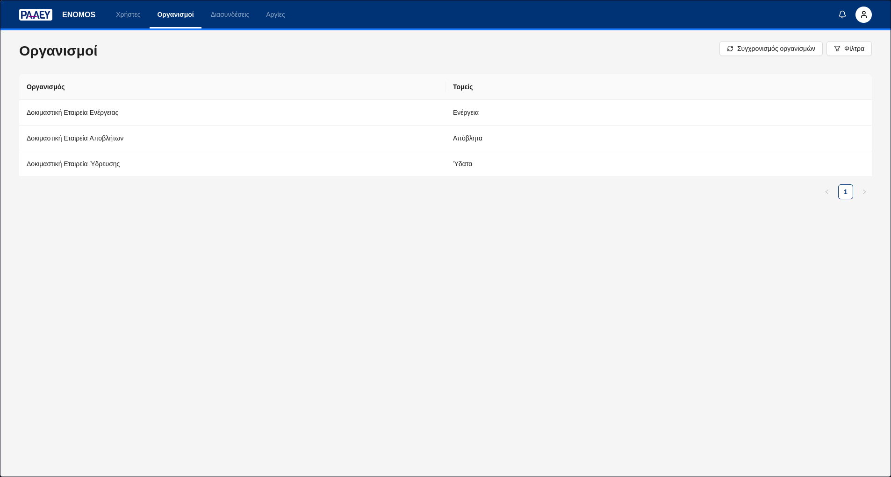
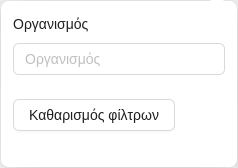

# Οργανισμοί

Η σελίδα **Οργανισμοί** συγκεντρώνει σε έναν πίνακα τους οργανισμούς (φορείς) της πλατφόρμας **Enomos**, στους οποίους απευθύνονται οι [αιτήσεις](applications.md).

!!! info

    Η σελίδα αυτή είναι διαθέσιμη μόνο στους **υπερδιαχειριστές** και στους **διαχειριστές**.

## Λίστα οργανισμών { #list }

Για κάθε οργανισμό, ο πίνακας εμφανίζει τις παρακάτω πληροφορίες:

| Στήλη | Περιγραφή |
|-------|-----------|
| **Οργανισμός** | Η επωνυμία του οργανισμού. |
| **Τομείς** | Οι [τομείς](users.md#domains) στους οποίους δραστηριοποιείται ο οργανισμός (**Ύδατα**, **Απόβλητα**, **Ενέργεια**). |

Κάτω από τον πίνακα εμφανίζεται το **πλήθος** των οργανισμών που ταιριάζουν στα φίλτρα (π.χ. **1–30 από 85**).

## Φίλτρα

Οι επιλογές φίλτρων βρίσκονται πάνω δεξιά από τον πίνακα. Μπορείτε να φιλτράρετε τους οργανισμούς με βάση:

- **Όνομα οργανισμού**: πληκτρολογήστε την επωνυμία ή μέρος της.

## Συγχρονισμός οργανισμών { #sync }

Οι οργανισμοί του Enomos προέρχονται από την πλατφόρμα **myraaey.gr**. Για να ενημερώσετε τη λίστα με τις τελευταίες αλλαγές, πατήστε το κουμπί **Συγχρονισμός οργανισμών** πάνω δεξιά από τον πίνακα.

!!! note

    Οι οργανισμοί συγχρονίζονται και **αυτόματα κάθε ώρα**. Χρειάζεται να πατήσετε το κουμπί μόνο αν θέλετε να δείτε άμεσα μια αλλαγή.
