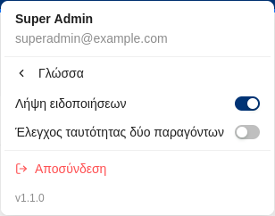

# Ρυθμίσεις

Οι ρυθμίσεις του λογαριασμού σας είναι διαθέσιμες από το **εικονίδιο χρήστη**, πάνω δεξιά στη σελίδα.

## Μενού χρήστη { #user-menu }

Πατώντας το εικονίδιο χρήστη εμφανίζεται ένα μενού με τις παρακάτω επιλογές:

| Επιλογή | Περιγραφή |
|---------|-----------|
| **Ονοματεπώνυμο και email** | Τα στοιχεία του λογαριασμού με τον οποίο είστε συνδεδεμένοι. |
| **Γλώσσα** | Αλλάζει τη γλώσσα της πλατφόρμας. |
| **Λήψη ειδοποιήσεων** | Ενεργοποιεί ή απενεργοποιεί όλες τις [ειδοποιήσεις](#notifications). |
| **Έλεγχος ταυτότητας δύο παραγόντων** | Ενεργοποιεί ή απενεργοποιεί τον [έλεγχο ταυτότητας δύο παραγόντων](#two-factor) κατά τη σύνδεση. |
| **Αποσύνδεση** | Αποσυνδέεστε από την πλατφόρμα. |

## Έλεγχος ταυτότητας δύο παραγόντων { #two-factor }

Από το [μενού χρήστη](#user-menu), ενεργοποιήστε την επιλογή **Έλεγχος ταυτότητας δύο παραγόντων** για να προσθέσετε ένα επιπλέον βήμα ασφαλείας στη [σύνδεσή](access.md) σας.

## Ειδοποιήσεις { #notifications }

Η πλατφόρμα σάς ενημερώνει για αλλαγές στις αιτήσεις σας με δύο τρόπους:

- **Στην εφαρμογή**: η ειδοποίηση εμφανίζεται άμεσα στη λίστα ειδοποιήσεων της πλατφόρμας.
- **Με email**: η ειδοποίηση αποστέλλεται στη διεύθυνση email του λογαριασμού σας.

| Ειδοποίηση | Πότε τη λαμβάνετε | Ποιος τη λαμβάνει | Στην εφαρμογή | Email |
|------------|-------------------|-------------------|:-------------:|:-----:|
| **Νέα αίτηση** | Όταν δημιουργείται μια αίτηση. | Οι **διαχειριστές** των [τομέων](users.md#domains) του φορέα της αίτησης. | ✓ | ✓ |
| **Ανάθεση αίτησης** | Όταν ορίζεστε [νομικός συνεργάτης](applications.md#assign-representative) μιας αίτησης. | Ο **νομικός συνεργάτης** που ορίστηκε. | ✓ | ✓ |
| **Υπενθύμιση προθεσμίας** | 3 ημέρες, 1 ημέρα και την ημέρα της [προθεσμίας](applications.md#deadline-reminders) μιας αίτησης, και την επόμενη ημέρα αν έχει περάσει. | Ο **νομικός συνεργάτης** της αίτησης ή, αν δεν έχει οριστεί, οι **διαχειριστές** των τομέων του φορέα της αίτησης. | ✓ | ✓ |
| **Ανάρτηση πρακτικού** | Όταν αναρτάται το [πρακτικό](applications.md#upload-minutes) μιας αίτησης. | Οι **διαχειριστές** των τομέων του φορέα της αίτησης. | ✓ | ✓ |
| **Νέο μήνυμα** | Όταν λαμβάνετε μήνυμα στη [συνομιλία](applications.md#view) μιας αίτησης ή απευθείας σε εσάς. | Ο **νομικός συνεργάτης** της αίτησης ή ο χρήστης στον οποίο απευθύνεται το μήνυμα. | ✓ | – |
| **Μη αναγνωσμένα μηνύματα** | Μία φορά την ημέρα, αν έχετε μηνύματα που δεν έχετε διαβάσει. | Κάθε χρήστης με μη αναγνωσμένα μηνύματα. | – | ✓ |
| **Η εξαγωγή συνομιλίας είναι έτοιμη** | Όταν ολοκληρωθεί η [εξαγωγή μιας συνομιλίας](applications.md#view) που ζητήσατε. | Ο χρήστης που ζήτησε την εξαγωγή. | ✓ | ✓ |
| **Η εξαγωγή αίτησης είναι έτοιμη** | Όταν ολοκληρωθεί η [εξαγωγή αιτήσεων](applications.md#export) που ζητήσατε. | Ο χρήστης που ζήτησε την εξαγωγή. | ✓ | ✓ |

!!! info

    Οι **υπερδιαχειριστές** λαμβάνουν μόνο ειδοποιήσεις για **μηνύματα που απευθύνονται απευθείας σε αυτούς**.

!!! note

    Οι ειδοποιήσεις αποστέλλονται **μόνο όταν η επιλογή Λήψη ειδοποιήσεων είναι ενεργή**. Αν την απενεργοποιήσετε, δεν λαμβάνετε καμία από τις παραπάνω ειδοποιήσεις, ούτε στην εφαρμογή ούτε με email. Εξαίρεση αποτελούν οι ειδοποιήσεις **εξαγωγής**, που φτάνουν πάντα στον χρήστη που ζήτησε την εξαγωγή. Οι [ανενεργοί χρήστες](users.md#activation) δεν λαμβάνουν ειδοποιήσεις.
