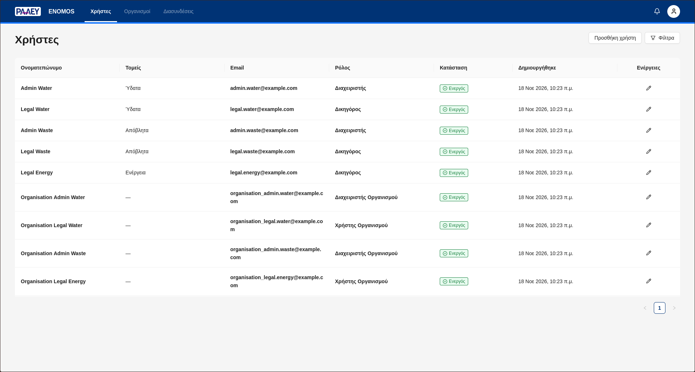
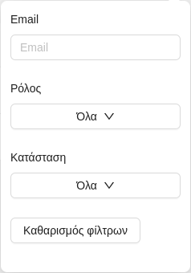
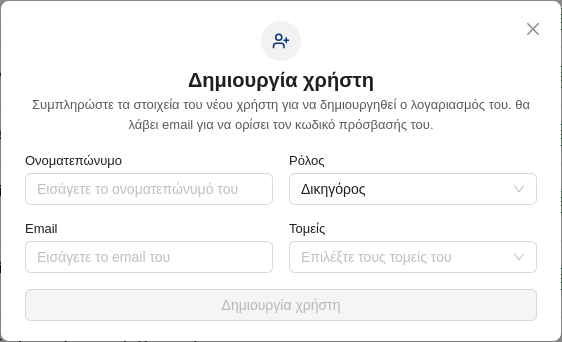
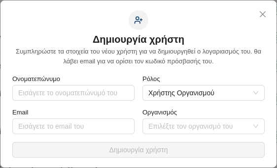
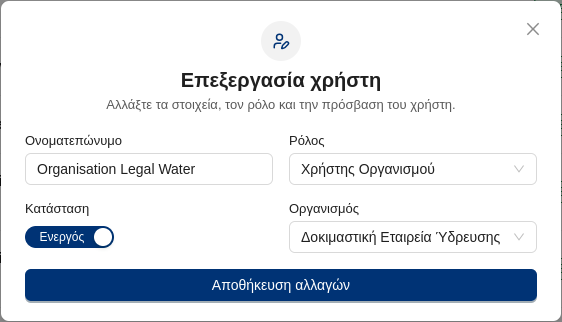

# Χρήστες

Η σελίδα **Χρήστες** συγκεντρώνει σε έναν πίνακα τους χρήστες της πλατφόρμας **Enomos**. Από εδώ μπορείτε να προσθέτετε νέους χρήστες και να διαχειρίζεστε τους υπάρχοντες.

!!! info

    Η σελίδα αυτή είναι διαθέσιμη μόνο στους **υπερδιαχειριστές** και στους **διαχειριστές**.

## Λίστα χρηστών { #list }

Οι χρήστες που εμφανίζονται στον πίνακα εξαρτώνται από τον ρόλο σας:

| Ρόλος | Χρήστες που βλέπετε |
|-------|---------------------|
| **Υπερδιαχειριστής** | Όλους τους χρήστες της πλατφόρμας. |
| **Διαχειριστής** | Τους χρήστες που μοιράζονται τουλάχιστον έναν [τομέα](#domains) μαζί σας. |

Για κάθε χρήστη, ο πίνακας εμφανίζει τις παρακάτω πληροφορίες:

| Στήλη | Περιγραφή |
|-------|-----------|
| **Ονοματεπώνυμο** | Το ονοματεπώνυμο του χρήστη. |
| **Email** | Το email του χρήστη, με το οποίο συνδέεται στην πλατφόρμα. |
| **Ρόλος** | Ο ρόλος του χρήστη (βλ. [Ρόλοι](#roles)). |
| **Κατάσταση** | Αν ο χρήστης είναι **Ενεργός** ή **Ανενεργός** (βλ. [Ενεργοποίηση και απενεργοποίηση](#activation)). |
| **Δημιουργήθηκε** | Η ημερομηνία δημιουργίας του χρήστη. |
| **Ενέργειες** | Οι διαθέσιμες ενέργειες για τον χρήστη (βλ. [Επεξεργασία χρήστη](#edit)). |

## Φίλτρα

Οι επιλογές φίλτρων βρίσκονται πάνω δεξιά από τον πίνακα. Μπορείτε να φιλτράρετε τους χρήστες με βάση:

- **Email**: πληκτρολογήστε το email ή μέρος του.
- **Ρόλος**: επιλέξτε έναν ή περισσότερους [ρόλους](#roles).
- **Κατάσταση**: επιλέξτε **Ενεργός** ή **Ανενεργός**.

## Ρόλοι { #roles }

Κάθε χρήστης έχει έναν από τους παρακάτω ρόλους. Οι τρεις πρώτοι είναι **εσωτερικοί χρήστες** της ΡΑΑΕΥ, οι δύο τελευταίοι **χρήστες φορέα**.

| Ρόλος | Τύπος | Περιγραφή |
|-------|-------|-----------|
| **Υπερδιαχειριστής** | Εσωτερικός | Διαχειρίζεται όλους τους χρήστες της πλατφόρμας. Δεν έχει τομείς και δεν έχει πρόσβαση στις [αιτήσεις](applications.md). |
| **Διαχειριστής** | Εσωτερικός | Βλέπει όλες τις αιτήσεις των τομέων του, [ορίζει νομικό συνεργάτη](applications.md#assign-representative), [ολοκληρώνει](applications.md#complete) τις αιτήσεις και διαχειρίζεται τους χρήστες των τομέων του. |
| **Δικηγόρος** | Εσωτερικός | Βλέπει τις αιτήσεις που του έχουν ανατεθεί και [αναρτά το πρακτικό](applications.md#upload-minutes). |
| **Διαχειριστής οργανισμού** | Φορέα | Βλέπει τις αιτήσεις που έχει διαμοιραστεί η ΡΑΑΕΥ με τον φορέα του και διαχειρίζεται τους χρήστες του φορέα. |
| **Χρήστης οργανισμού** | Φορέα | Βλέπει τις αιτήσεις του φορέα στις οποίες έχει οριστεί νομικός συνεργάτης. |

### Τομείς { #domains }

Οι εσωτερικοί χρήστες, εκτός από τους υπερδιαχειριστές, ανήκουν σε έναν ή περισσότερους **τομείς**: **Ύδατα**, **Απόβλητα**, **Ενέργεια**. Ο τομέας καθορίζει ποιες αιτήσεις και ποιους χρήστες βλέπει ο χρήστης.

## Προσθήκη χρήστη { #create }

1. Πατήστε το κουμπί **Προσθήκη χρήστη** πάνω δεξιά από τον πίνακα.
2. Συμπληρώστε τη φόρμα:

    | Πεδίο | Περιγραφή |
    |-------|-----------|
    | **Ονοματεπώνυμο** | Το ονοματεπώνυμο του χρήστη. |
    | **Ρόλος** | Ο [ρόλος](#roles) του χρήστη. |
    | **Email** | Το email του χρήστη, με το οποίο θα συνδέεται στην πλατφόρμα. |
    | **Τομείς** | Μόνο για **διαχειριστές** και **δικηγόρους**. Οι [τομείς](#domains) του χρήστη. |
    | **Φορέας** | Μόνο για **χρήστες φορέα**. Ο φορέας στον οποίο ανήκει ο χρήστης. |

3. Πατήστε **Αποθήκευση**.

=== "Εσωτερικός χρήστης"

    

=== "Χρήστης φορέα"

    

!!! info

    Οι **υπερδιαχειριστές** δεν έχουν τομείς. Όταν ένας **διαχειριστής** προσθέτει εσωτερικό χρήστη, δεν επιλέγει τομέα· ο νέος χρήστης **κληρονομεί τους τομείς** του διαχειριστή.

!!! note

    Ο νέος χρήστης δημιουργείται ως **Ενεργός** και λαμβάνει **email** με οδηγίες για να ορίσει τον κωδικό του. Στη συνέχεια μπορεί να [συνδεθεί](access.md) στην πλατφόρμα.

## Επεξεργασία χρήστη { #edit }

Για να επεξεργαστείτε έναν χρήστη, πατήστε **Επεξεργασία** στη στήλη **Ενέργειες** του [πίνακα χρηστών](#list). Μπορείτε να αλλάξετε:

- το **ονοματεπώνυμο**,
- τον **ρόλο**,
- τους **τομείς**, για εσωτερικούς χρήστες (μόνο οι υπερδιαχειριστές),
- τον **φορέα**, για χρήστες φορέα,
- την **κατάσταση** του χρήστη (ενεργός ή ανενεργός).

!!! warning

    Ένας εσωτερικός χρήστης **δεν μπορεί να μετατραπεί** σε χρήστη φορέα, ούτε το αντίστροφο. Ο νέος ρόλος πρέπει να είναι του ίδιου τύπου.

### Ενεργοποίηση και απενεργοποίηση { #activation }

Από τη φόρμα επεξεργασίας μπορείτε να **απενεργοποιήσετε** έναν χρήστη ή να **ενεργοποιήσετε** ξανά έναν ανενεργό χρήστη.

!!! warning

    Οι ανενεργοί χρήστες:

    - **δεν εμφανίζονται** στις επιλογές του [ορισμού νομικού συνεργάτη](applications.md#assign-representative),
    - **δεν λαμβάνουν** ειδοποιήσεις.
